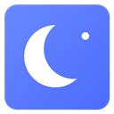
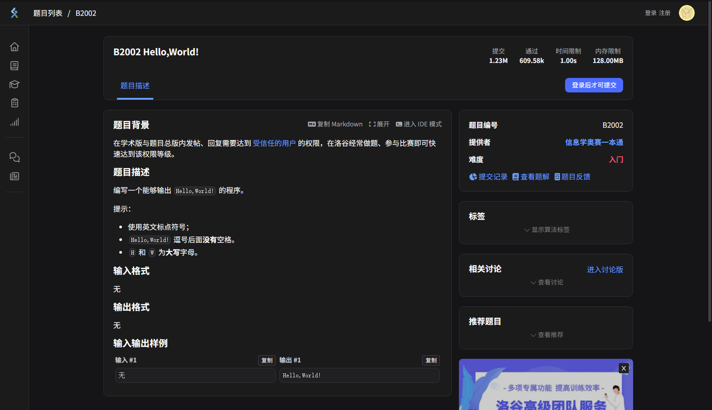
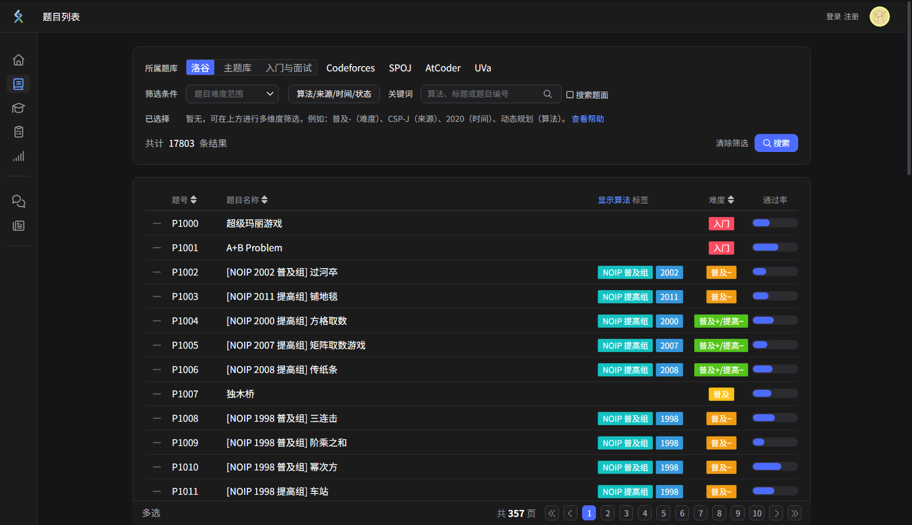

<div align="center">



# 洛谷深色模式 · DeepSeek 风

为洛谷刷题页面打造的深灰低眩光主题，配色参考 DeepSeek 网页版深色模式。  
纯 CSS、Manifest V3：无 JavaScript、无权限申请、不收集任何数据。


[预览](#预览) · [安装](#安装) · [配色](#配色) · [自定义](#自定义) · [常见问题](#常见问题)

</div>

## 预览





> 截图使用 Edge 无头模式、未登录状态拍摄，仅展示主题效果。

## 特点

- **DeepSeek 风格深灰分层**：主背景 `#151517`、卡片 `#1b1b1c`、浮层与输入框 `#202022`，不是刺眼的纯黑。
- **纯 CSS 实现**：没有内容脚本逻辑，不读取页面数据，不发起网络请求。
- **新版 + 旧版前端一起覆盖**：题面、题库、筛选弹窗、首页、比赛、训练题单、文章区、讨论区、个人主页等。
- **保留语义色**：难度、算法标签、比赛状态等使用洛谷原有颜色，不破坏信息表达。
- **代码块深色化**：题面中的行内代码、示例代码块和代码高亮都做了适配。
- **细节处理**：输入框、下拉菜单、分页、标签页、滚动条、选中文本、热力图、广告图亮度。
- **可自定义**：所有关键色都在 `luogu-dark.css` 顶部的 CSS 变量里，改几行就能换风格。

## 安装

### Edge

1. 下载本仓库的 ZIP（`Code → Download ZIP`），或从 [Releases](https://github.com/Chu-913/luogu-deepseek-theme/releases) 下载发布包并解压。
2. 打开 `edge://extensions`。
3. 打开左侧的「开发人员模式」。
4. 点击「加载解压缩的扩展」，选择解压后的文件夹（里面有 `manifest.json`）。
5. 打开洛谷并刷新页面。

### Chrome

1. 打开 `chrome://extensions`。
2. 打开右上角的「开发者模式」。
3. 点击「加载已解压的扩展程序」，选择解压后的文件夹。
4. 打开洛谷并刷新页面。

### 更新

修改文件或拉取新版本后，在扩展管理页点击该扩展的「重新加载」，再回到洛谷按 `Ctrl + F5` 强制刷新即可。

> 请保留扩展文件夹，不要移动或删除；这是「加载解压缩」扩展的运行目录。

## 配色

配色取自 DeepSeek 官方深色页面，并按照洛谷的信息层级做了适配。

| 变量 | 色值 | 用途 |
| --- | --- | --- |
| `--lg-bg` | `#151517` | 页面主背景 |
| `--lg-surface` | `#1b1b1c` | 卡片、顶栏、侧栏 |
| `--lg-surface-2` | `#202022` | 输入框、弹窗、代码块 |
| `--lg-surface-3` | `#262628` | 悬浮、选中、下拉菜单 |
| `--lg-border` | `#303035` | 卡片描边 |
| `--lg-border-strong` | `#414148` | 输入框、浮层描边 |
| `--lg-text` | `#f2f3f5` | 正文 |
| `--lg-text-strong` | `#f9fafb` | 标题、重点文字 |
| `--lg-text-dim` | `#a6a7ab` | 次要文字 |
| `--lg-text-faint` | `#77787d` | 占位符、辅助信息 |
| `--lg-accent` | `#679efe` | 链接、当前导航图标 |
| `--lg-primary` | `#4d6bfe` | 主按钮、选中项、进度条 |
| `--lg-focus` | `#5686fe` | 输入框聚焦描边 |

## 自定义

打开 `luogu-dark.css`，最顶部的 `:root` 就是整套配色：

```css
:root {
  --lg-bg: #151517;
  --lg-surface: #1b1b1c;
  --lg-surface-2: #202022;
  --lg-accent: #679efe;
  --lg-primary: #4d6bfe;
  /* ... */
}
```

例如想要更接近 OLED 的纯黑风格：

```css
--lg-bg: #000000;
--lg-surface: #0a0a0a;
--lg-surface-2: #111111;
```

或者想要更亮的深灰：

```css
--lg-bg: #1b1b1c;
--lg-surface: #232326;
--lg-surface-2: #2a2a2e;
```

改完后在扩展管理页点击「重新加载」，刷新洛谷即可。

## 文件结构

```text
luogu-deepseek-theme/
├── manifest.json          # Manifest V3 清单
├── luogu-dark.css         # 全部主题样式（含分区注释）
├── icons/                 # 16 / 32 / 48 / 128 图标
├── screenshots/           # README 预览图
├── CHANGELOG.md
├── LICENSE
└── README.md
```

`luogu-dark.css` 按模块分段：页面底色、顶栏与侧栏、卡片、文字层级、表单、标签页与分页、题面 Markdown、弹窗、按钮、旧版前端、滚动条。每段都有中文注释，方便定位和二次修改。

## 常见问题

### 安装后没有变化？

- 确认已经打开扩展的「开发人员模式」，并在 `edge://extensions` / `chrome://extensions` 中看到本扩展。
- 在扩展管理页点一次「重新加载」，然后回洛谷按 `Ctrl + F5`。
- 本扩展只匹配 `*.luogu.com.cn`，不会影响其他网站。

### 某些页面还有白块或看不清的文字？

不同洛谷页面使用的组件不一样，本主题已经覆盖常用页面，但站点更新后可能出现遗漏。欢迎带上页面链接和截图提交 Issue。

### 会收集数据吗？

不会。扩展没有申请任何权限，只注入一份 CSS；没有 JavaScript、没有网络请求、没有统计代码。

### 为什么不用纯黑？

纯黑在 OLED 屏幕上对比度很强，但大面积纯黑加纯白文字容易产生光晕和视觉疲劳。本主题采用 DeepSeek 网页版的深灰分层；如果你更喜欢纯黑，可以用上面的「自定义」改成 `#000000`。

### 洛谷 IDE / 编辑器为什么没有变暗？

如果站点使用 Monaco 等 Canvas 渲染的编辑器，编辑器内部主题由站点自身的 JavaScript 控制，CSS 扩展无法可靠覆盖。本扩展会处理外围界面和普通代码块。嵌入的第三方视频/页面同样不受控制。

## 贡献

欢迎提交 Issue 或 Pull Request：

- 新页面适配请附上页面链接和截图。
- 修改颜色时请优先使用 `:root` 中的变量，保持整体一致。
- 不要引入远程字体、图片或统计脚本。
- 提交前至少在题面页、题库列表页和首页各检查一次。

## 声明

本项目是非官方的个人主题项目，与洛谷（Luogu）及 DeepSeek 均无隶属关系。相关名称、商标和内容归各自所有者所有。使用本主题产生的任何问题由使用者自行承担。

## English

A DeepSeek-inspired dark theme for [Luogu](https://www.luogu.com.cn/). Pure CSS, Manifest V3, no permissions and no data collection. Load the folder as an unpacked extension in Edge or Chrome, then refresh Luogu. See the Chinese sections above for installation and customization details.

## License

[MIT](LICENSE) © 2026 Chu-913
